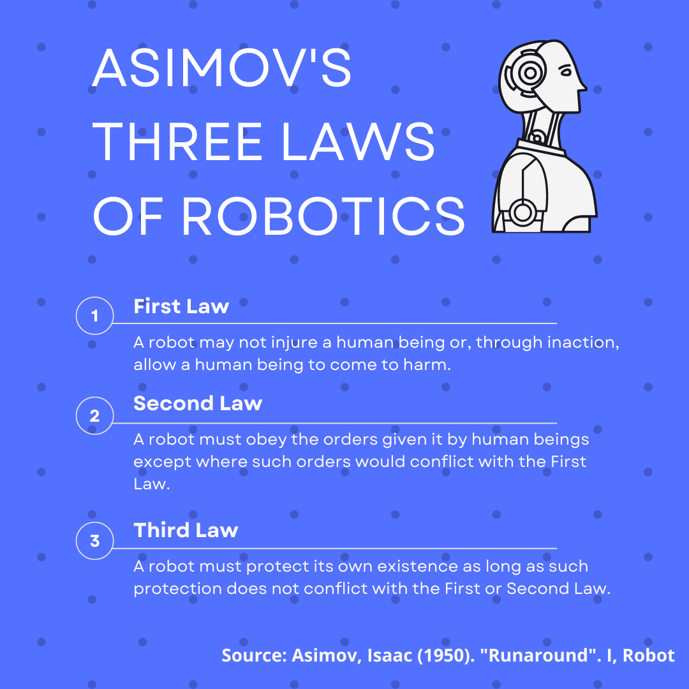
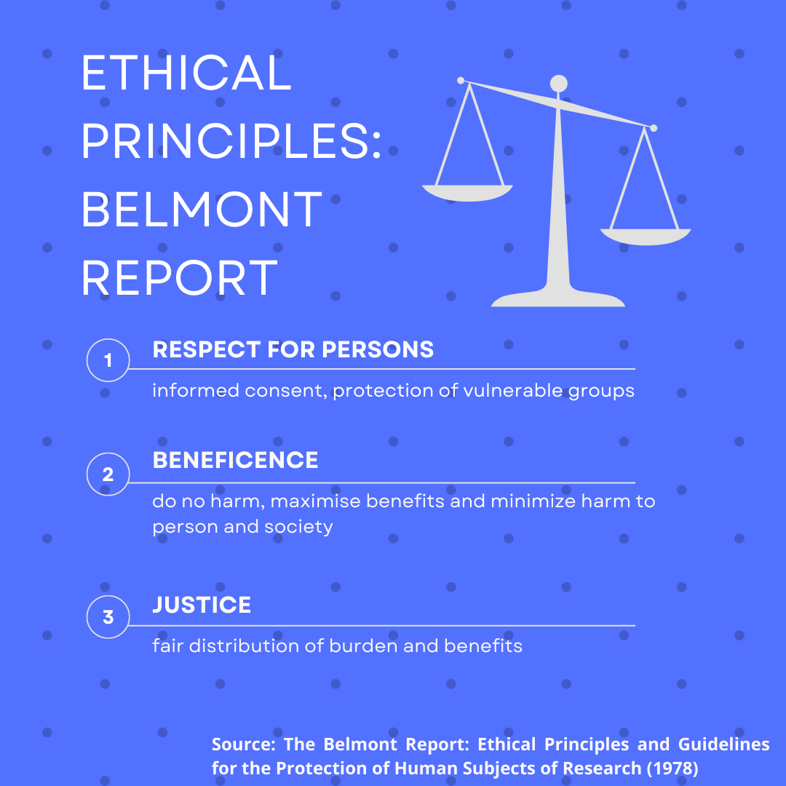

*Originally posted in January 2023 in [HashDork](https://hashdork.com/ethical-ai/).*

How do we make sure that we use AI responsibly?

Advancements in machine learning show that models can quickly scale and impact a large portion of society.

Algorithms control the newsfeed on everybody’s phones. Governments and corporations are starting to use AI to make data-informed decisions.

As AI becomes further ingrained in how the world operates, how do we make sure that the AI is acting fairly?

In this article, we will look into the ethical challenges of using AI and see what we can do to ensure the responsible use of AI.

## What is Ethical AI?

Ethical AI refers to artificial intelligence that adheres to a certain set of ethical guidelines.

In other words, it’s a way for individuals and organizations to work with AI in a responsible manner.

In recent years, corporations have started to stick to data privacy laws after evidence of abuse and breach came to light. Similarly, guidelines for ethical AI are recommended to make sure that AI does not negatively affect society.

For example, some types of AI work in a biased manner or perpetuate already existing biases. Let’s consider an algorithm that helps recruiters sort through thousands of resumes. If the algorithm is trained on a dataset with predominantly male or white employees, then it’s possible that the algorithm will favor applicants that fall under those categories.

## Establishing Principles for Ethical AI

We have thought about establishing a set of rules to impose on [artificial intelligence](https://hashdork.com/what-is-artificial-intelligence/) for decades.

Even in the 1940s, when the most powerful computers could only do the most specialized scientific calculations, science fiction writers have pondered over the idea of controlling intelligent robots.

Isaac Asimov famously coined the Three Laws of Robotics, which he proposed was embedded into the programming of robots in his short stories as a safety feature.

These laws have become a touchstone to many future sci-fi stories and have even informed actual studies on the ethics of AI.

In contemporary research, AI researchers are looking into more grounded sources to establish a list of principles for ethical AI.

Since AI will ultimately affect human lives, we must have a fundamental understanding of what we should and should not be doing.

### The Belmont Report

For a reference point, ethics researchers look into the Belmont Report as a guide. The [Belmont Report](https://www.hhs.gov/ohrp/regulations-and-policy/belmont-report/index.html) was a document published by the U.S. National Institutes of Health in 1979. Biomedical atrocities performed in WW2 led to a push to legislate ethical guidelines for researchers practicing medicine.

Here are the three foundational principles mentioned in the report:

1. Respect for persons
2. Beneficence
3. Justice

The first principal aims to uphold the dignity and autonomy of all human subjects. For example, researchers should minimize deceiving participants and should require each person to give their explicit consent.

The second principle, beneficence, focuses on the researcher’s duty to minimize potential harm to participants. This principle gives the researchers the duty to balance the ratio of individual risks to potential social benefits.

Justice, the final principle laid out by the Belmont Report, focuses on equal distribution of risks and benefits across groups who could benefit from the research. Researchers have the duty to select research subjects from the broader population. Doing so would minimize individual and systemic biases that could negatively affect society.

### Placing Ethics in AI Research

While the Belmont Report was primarily targeted at research involving human subjects, the principles were broad enough to apply to the field of AI ethics.

Big Data has become a valuable resource in the field of artificial intelligence. The processes that determine how researchers collect data should follow ethical guidelines.

The implementation of data privacy laws in most nations somewhat puts a limit on what data companies can collect and use. However, the majority of nations still have a rudimentary set of laws in place to prevent the use of AI to cause harm.

## How to Work with AI Ethically

Here are a few key concepts that can help work towards a more ethical and responsible use of AI.

### Control for Bias

Artificial intelligence is not inherently neutral. Algorithms are always susceptible to inserted bias and discrimination because the data it learns from includes bias.

A common example of discriminatory AI is the type that frequently appears in facial recognition systems. These models often succeed at identifying white male faces, but are less successful at recognizing people with darker skin.

Another example appears in OpenAI’s DALL-E 2. Users have [discovered](https://www.wired.com/story/dall-e-2-ai-text-image-bias-social-media/) that certain prompts often reproduce gender and racial biases that the model has picked up on from its dataset of online images.

For instance, when given a prompt for images of lawyers, DALL-E 2 returns images of male lawyers. On the other hand, requesting for pictures of flight attendants returns mostly women flight attendants.

While it may be impossible to completely remove bias from AI systems, we can take steps to minimize its effects. Researchers and engineers can achieve greater control of bias by understanding the training data and hiring a diverse team to offer input on how the AI system should work.

### Human-centered design approach

Algorithms on your favorite app can negatively affect you.

Platforms such as Facebook and TikTok are able to learn what content to serve to keep users on their platforms.

Even without the intention to cause harm, the objective to keep users glued to their app for as long as possible could lead to mental health issues. The term ‘doomscrolling’ has risen in popularity as the catch-all term for spending excessive amounts of time reading negative news on platforms such as Twitter and Facebook.

In other cases, hateful content and misinformation receive a wider platform because it helps increase user engagement. A [2021 study](https://www.washingtonpost.com/technology/2021/09/03/facebook-misinformation-nyu-study/) from researchers at New York University shows that posts from sources known for misinformation get six times more likes than reputable news sources.

These algorithms are lacking in a human-centered design approach. Engineers who are designing how an AI performs an action must always keep the user experience in mind.

Researchers and engineers must always ask the question: ‘how does this benefit the user?’

### Explainable AIs

Most AI models follow a black box model. A black box in [machine learning](https://hashdork.com/machine-learning/) refers to an AI where no human can explain why the AI arrived at a particular result.

Black boxes are problematic because it decreases the amount of trust we can put in machines.

For example, let’s imagine a scenario where Facebook released an algorithm that helped governments track down criminals. If the AI system flags you, nobody will be able to explain why it’s made that decision. This type of system shouldn’t be the sole reason why you should get arrested.

Explainable AI or XAI should return a list of factors that contributed to the final result. Going back to our hypothetical criminal tracker, we can tweak the AI system to return a list of posts showing suspicious language or terms. From there, a human can verify whether the flagged user is worth investigating or not.

XAI provides more transparency and trust in AI systems and can help humans make better decisions.

## The Work Ahead

Like all man-made inventions, artificial intelligence is not inherently good or bad. It is the way we use AI that matters.

What’s unique about artificial intelligence is the pace at which it is growing. In the past five years, we’ve seen new and exciting discoveries in the field of machine learning every day.

However, the law is not as quick. As corporations and governments continue to leverage AI to maximize profits or seize control of citizens, we must find ways to push for transparency and equity in the use of these algorithms.

Do you think truly ethical AI is possible?
