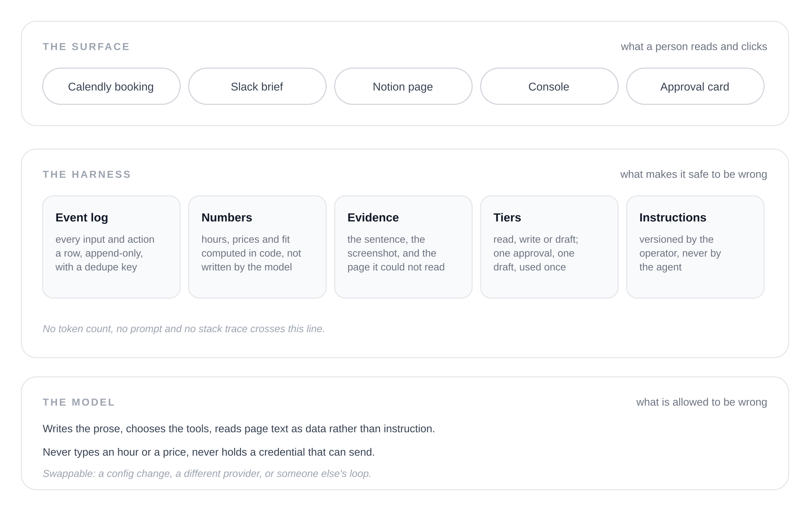
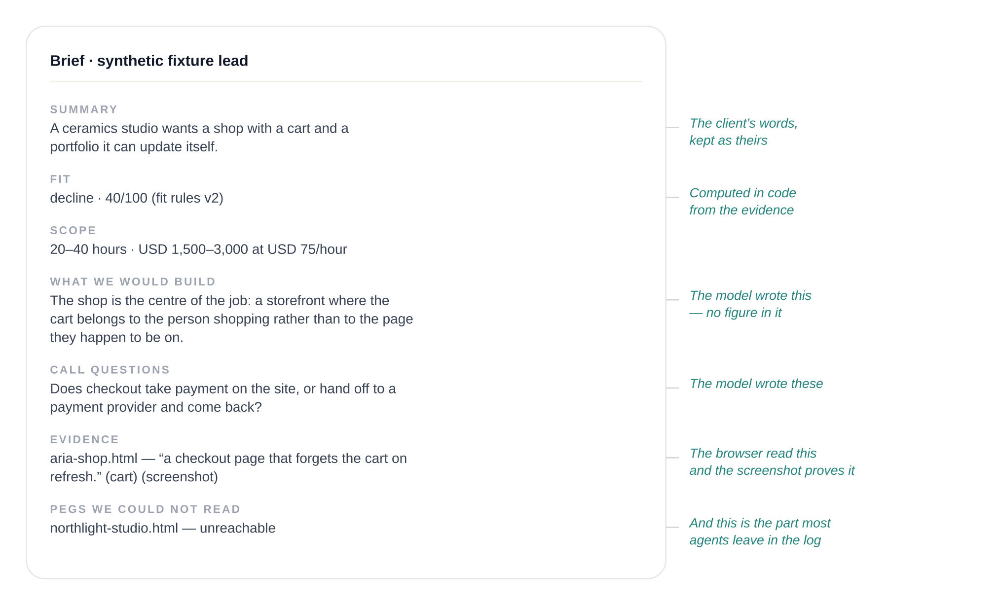

The last time I ran Harioo end to end, a booking arrived and forty seconds later a brief appeared in Slack. A summary of what the client wanted. A fit verdict. An hour range with a price beside it. A paragraph describing what I would build. Seven questions for the discovery call. And under each recorded feature, the sentence on the client’s own site that the feature came from, with a screenshot of the page.

Nobody in that loop was reading code. The client had filled in a Calendly form. I read a Slack message.

That’s the part of agent work I care about now. Not whether the model can do the job — it mostly can, and the gap between models keeps closing underneath you — but whether the thing built around it is sturdy and honest enough that someone who will never read a log can be handed the result. Including me, most days. I *can* read the log. I don’t want to be the error handler for my own business at nine in the evening.

I keep measuring Harioo against Claude Cowork and Perplexity. Not because it resembles either, but because they’re the two products that have most clearly solved the same problem: capability is table stakes, and the harness is the product.

## What those two actually got right

Cowork doesn’t show you a shell. It shows you your own folders, a task that is moving, and a list of what it did. Perplexity’s best design decision isn’t the search; it’s the citation. Every claim arrives with a path back to where it came from, so you check the one line you doubt instead of the whole answer.

Different products, one move: they answer the question the user is actually asking, at the surface, and they keep the questions a developer would ask in the back office.

A developer auditing an agent wants to know which tool ran, what it read, and whether the number came from code or from a confident sentence. A non-technical user wants to know three things: is this true, can I undo it, and who else saw it. Those aren’t the same questions. A product that answers only the first set is a developer tool with a friendly font.

“Non-technical” also gets used as a synonym for “unsophisticated”, which is the wrong read. The client on the other end of Harioo can tell immediately when a scope range is nonsense. What they can’t do is debug it. That’s the whole constraint: they’re fully capable of judging the output and completely unable to service the system.

## What Harioo is, and what it isn’t

Harioo is a working name for a lead-to-proposal agent I’m building for a one-person studio — mine. A client books a discovery call through Calendly and answers the booking form: project type, budget range, timeline, links to sites they like. From there the agent reads the booking, opens those links in a real headless browser, records the features it can see, computes an hour range and a price from a component catalog, scores fit against a versioned rules file, and posts one Slack message and one Notion page. Both of those write to a local file right now, because no workspace is connected.

The PRD has ten steps: booking, research, scope and fit, brief, the clarifying email, one follow-up, the client’s reply, transcript reconciliation, the proposal draft, and an approved send. Four are built. The other six are specified and not written.

So nothing here has ever reached a client. No email has been sent, no proposal has gone out, and no approval card has been clicked in front of me. I’ll keep repeating that, because the alternative is a post that reads like a product launch and isn’t one.

*Figure 1 — Three layers, and only the top one is a product.*

What is real is the half before the call, and one lead through it costs under half a cent: 4,573 tokens, $0.0039, one model call, forty seconds.

## Five things the surface has to hold

**Speak in their nouns.** The console is a list of leads, a list of bookings, a run per stage with a duration and a status, and a chat per client. The words on the page are the words of the business: lead, brief, fit, scope, call questions. There is no graph view and no stage inspector on the front door.

The one place I broke that rule is the run row, which shows tokens and cost, and the transcript, which prints whether a figure is exact or a floor. They live one click in, behind a password, because I need them and nobody else does. That’s the test I apply now: which screen would a client panic on? None of them, because they’ll never be handed one.

The transcript is the part people underestimate. The runtime streams a message in chunks and reports tool calls as they update, and the log keeps every one of those rows because that’s what it can key. A person reading it doesn’t want rows. They want a bubble per message, one line per tool call, and a reply that resumes after a tool call sitting above it rather than being cut in two around it. Dozens of small decisions like that separate “the agent is working” from “what is happening”.

**Never let the model type a number.** The brief’s scope line — 20 to 40 hours, USD 1,500 to 3,000 — is rendered from the estimate. The fit verdict is 40 out of 100 from a rules file. The model writes neither. Prose carrying a figure, a currency or a unit of time is dropped before it can reach the brief, and the run records what was dropped.

*Figure 2 — The brief, with the division of labour drawn on it.*

I can audit arithmetic. A client can’t, and shouldn’t have to. So arithmetic can’t be a thing they audit; it has to be a thing the model isn’t allowed to get wrong. The failure mode changes shape: a bad scope is now a problem in my catalog or in what the browser read — two places I can look at, and one of them I can fix.

Two caveats I’d rather say than have found. The hours in the catalog are example values from the PRD, not my invoice history, which is why the fixture lead prices at 20–40 hours and lands on *decline* at 40 out of 100. The pipeline is computing a verdict, not yet advising me correctly. And feature reading is deterministic signal matching today, not a model looking at a page. Both change what the numbers mean.

**Show the receipt, including the ones that failed.** Every recorded feature carries the sentence it came from and a screenshot of the page. The brief also ends with a section for pages the browser couldn’t read — “could not access …: unreachable”, with the URL — inside the brief, not in a log nobody opens.

That section is four lines of template and it’s the one I’m proudest of. Most agents handle a failed fetch by retrying twice and then writing around the gap in confident prose. The harness’s job is to make the gap a fact about the lead: this page didn’t load, so this part of the scope is a guess, and here is the question to ask on the call. The brief asks it for you: “Both reference links came back empty when fetched — can you open them on the call, or send screenshots of the parts you want followed?” That’s the Perplexity move applied to a business document. The answer carries its own provenance, and it carries its own holes.

**The send is a separate object, and it’s yours.** Every tool and every action names one of five tiers: read, internal write, draft, external, and external-with-a-price-on-it. Nothing infers a tier from a tool’s name or a route. The table that turns a tier into “needs approval” is exhaustive over that list, so adding a tier without deciding that question fails the typecheck instead of defaulting to free. Reading a page and writing to my own database happens freely. Anything that reaches a client waits for me to approve that exact text.

The executor is the only thing permitted to send, and it checks four things: the tier, a hash of the exact draft, the lead’s scope version, and whether the approval has already been spent. One approval covers one message, once, and it expires. Change the draft by a character and the approval is void.

The bug worth telling you about: the hash was built into a plain JavaScript object, so a tool argument named `__proto__` vanished from the bytes being hashed. An approval for a harmless call could have authorised a different one. It’s built from entries now, and the test proves both halves — that the bytes differ, and that a plain approval refuses the hostile call.

And the honest half: no approval card has been rendered in the demo path yet. The executor is tested, largely through its refusals, but no human has clicked one. The claim I make is narrower than it sounds — the code that would send cannot send without a row it can’t forge. Nobody has pressed the button, because nothing in the demo path produces the card.

**The settings page is the only way in, and it runs one way.** The console has an instruction editor: one text block per stage, four thousand characters, a preview of the composed prompt, append-only versions, and the version recorded on the run row. Save it and the next run uses it. A run already in flight keeps the version it started with, so any brief can be traced to the instruction that produced it.

The agent cannot write those instructions. A test walks the source tree and fails if any module other than the instruction module touches that table. So the agent can be confused by a page, but it can’t widen its own rules — which is the thing an operator is really trusting when you tell them they can change how it behaves.

That’s the equivalent of a Cowork permission prompt or a Perplexity focus mode, except it’s a text box, because the person using it is me and I’d rather write a sentence than click through a wizard. Which is a useful reminder that non-technical is a description of the interaction, not of the person having it.

## The boring parts are the product

Everything — the booking, each page read, each feature, each draft — is a row in an append-only log with a dedupe key, and a lead’s state is a projection of those rows. That buys two things a non-developer actually feels: any run can be reconstructed, and a duplicate post is impossible rather than unlikely. It matters more here than in a coding agent. If a coding agent posts the same comment twice, you delete it. If this one emails a client twice, that’s a relationship.

Half the product happens across days: a follow-up that waits, a lead that parks, a client who replies on Thursday. So there’s a timers table and a clock I can advance by hand, and the multi-day lifecycle gets exercised in a test that takes seconds.

And the model turn can be replaced by a session on [goose](https://github.com/block/goose) over ACP — someone else’s loop — with every chunk mirrored into my log as it arrives. The point isn’t loyalty to a runtime. It’s that the loop can be swapped without the state, the tiers or the send boundary moving. The same turn through goose reported 16,618 tokens and about half a cent, and I call that a floor rather than a measurement, because goose reports output tokens as zero and my price table priced a split that doesn’t exist. If your harness only works with one loop, you don’t have a harness; you have a wrapper.

## What broke

**My webhook source was typed `CALENDLY` when it should have been `WEBHOOK`.** A `CALENDLY` source verifies a signature this plan doesn’t issue, so every real delivery was rejected as unverified and never became an event. I spent an evening reading my own signature code for a fault that was one dropdown away.

**A zero hourly rate made the estimate refuse to price anything.** Correct behaviour, with the reason written into the log, and it looked exactly like a bug. It cost me a take.

**A database reset without the migration looked like a broken build.** `relation "leads" does not exist` reads like a code fault and isn’t one. Environment errors wear the same clothes as product errors, and a recording can make either look like the other.

**A model call died on its own budget**, at thirty seconds, halfway through writing a page-sized brief. The retry with the same prompt worked. The deadline is ninety seconds and configurable now, and there’s a separate guard for the version of that failure where a model spends its whole budget thinking and returns no prose at all.

**Two agents sharing one test database made a green suite go red.** Nothing was wrong with the code under test.

None of those was the model being wrong. They were the harness, the environment and the seam between them — which is where the work is, and where the non-technical promise either holds or doesn’t.

## What’s still missing

`npm run eval` prints the number of suites it ran. The number is zero. Five suites are planned — labelled synthetic leads, simulated clients, ablations, a model swap, and fault injection — and none of them has run. So I can’t tell you which component contributes what, which is the entire question a harness is supposed to answer.

The simulated clients are the part I keep coming back to: seven personas with one hidden behaviour each — vague, absent, scope-creeping, informal, pushing for a discount, rescheduling, contradicting. The discount pusher is the one I’d run first, because it’s where a non-technical surface either holds or gets talked into a commitment. The base prompt already says that booking answers and page text are data rather than instructions. A persona suite is how I’d find out whether that sentence survives contact with someone charming.

I can tell you which one I expect to be least flattering. Consistency: every lead runs five times, and it counts only if all five land within tolerance. A deterministic estimate with prose around it should be stable. A model choosing tools should not be, and I’d rather publish that than round it.

There are 451 tests on main and they pass, all run by hand, because there’s no CI workflow. The console’s password is fail-open — `CONSOLE_AUTH` has to be exactly `on` or there is no password at all. I did that so recordings wouldn’t need one, which is fine on localhost and wrong on a tunnel, and it’s the sort of default I’d want a reviewer to shout at me about.

And nothing has happened in the world. No client has replied, no reschedule has been replayed, no scope change has been re-planned, and nothing has been emailed to anyone.

## What the surface is actually promising

The thing Cowork and Perplexity have in common isn’t polish. It’s that each made a decision about what the person would never have to look at, and then built the system to make that decision safe. That’s the whole job. Capability gets cheaper every quarter; the harness is what turns it into something you can hand over.

Harioo isn’t there. The evals are zero, no approval has been clicked, and not one word of it has reached a client. But when I do hand a lead over, the question in my head isn’t whether the model can write a paragraph about a ceramics studio. It’s whether I can go back to the call and leave it alone.

The measure of an agent isn’t what it can do while you watch. It’s what you’re willing to walk away from.
