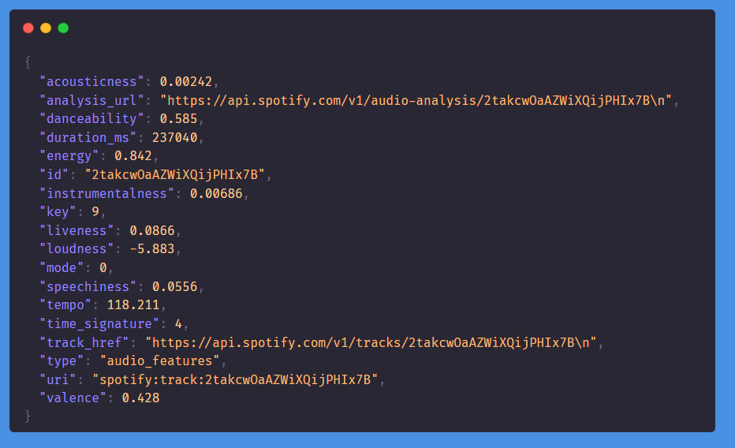
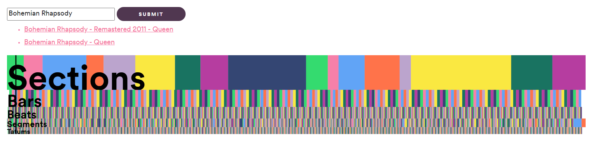
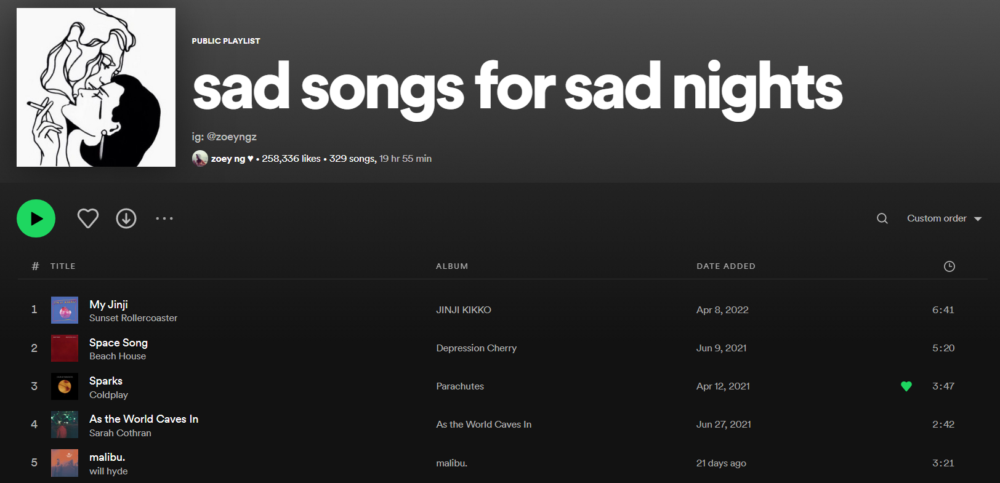

*Originally posted on May 16, 2025 in [HashDork](https://hashdork.com/how-spotify-uses-machine-learning-for-playlists/).*

The rise of music streaming services has completely changed how the current generation of listeners approach music. Not only are millions of songs available for a small monthly subscription fee, algorithms actively work in the background to deliver a constant stream of music personalized to your taste.

Leading the music streaming wars is the Swedish-based company Spotify. The platform has grown to amass over 400 million monthly active users in 2022. Apart from being the largest on-demand music service, Spotify constantly pushes the boundaries of AI and [machine learning](https://hashdork.com/best-books-on-machine-learning/) in the context of music and music recommendation.

Playlists such as Discover Weekly or Daily Mix are created using a complex system of algorithms that try to match artists and listeners together. This article will shine a light on how Spotify works behind the scenes. We will dive into how all these algorithms work together to create an effective music curating services for users.

## How Does Spotify Recommend You Things?

Spotify relies on what is known as a recommender system. Also known as a recommendation engine, the algorithm creates a model to find and recommend relevant items to users. Spotify has built an effective recommender system tailored for delivering customized playlists and track suggestions to its users.

This type of algorithm is practically ubiquitous in our daily life. Recommender systems drive the features that allow Amazon, YouTube, and Facebook to give you relevant content based on your past interactions with the app.

Spotify’s recommender engine needs to get two representations right: the user and the music track itself.

## Representing Music Tracks

Before Spotify can suggest music to you, its algorithms must have some quantitative way of describing each of the millions of tracks in their database.

Creating a profile for each music track is an interesting problem in itself. Spotify has invested in plenty of research to find the best models to describe every record in its catalog.

To tackle this problem, Spotify uses two main methods to create a representation: content-based filtering and collaborative filtering.

Let’s look into what each of these methods does and how they work together to create a holistic representation of music.

### Content-based Filtering

Content-based filtering aims to describe each track by examining the actual data and metadata of the track.

When artists upload music to Spotify’s database, they must provide the actual music file itself, as well as additional information or metadata. Metadata includes the name of the song, the year it was released, the track’s album, and even the length of the song itself.

When Spotify receives these files, it can quickly use the provided metadata to categorize songs. A British rock single from 1989, for example, can be put into several playlists such as “Classic British Hits” or even “Rock Songs from the 80s”.

#### Raw Audio Analysis

However, Spotify goes a step further and performs an analysis on the raw audio file itself to get some quantitative metrics from the track. If we take a look at the [Spotify API](https://developer.spotify.com/documentation/web-api/reference/#/operations/get-audio-features), we can see a few of these metrics.

For example, the API includes an energy metric that measures the “perceptual measure of intensity and activity.” According to the documentation, the metric is derived from various attributes including dynamic range, perceived loudness, and timbre. Using this metric, Spotify can categorize high-energy songs together and serve them as recommendations to users who listen to high-intensity music.

Besides energy, Spotify also determines the liveness of the track, a metric that detects the presence of an audience in the recording. Valence is a measurement that describes how positive a track is. A high valence sound indicates cheerful and happy music, while a lower valence sound indicates sad, depressed, or angry music.

#### Temporal Analysis

Spotify also has another interesting analytics algorithm that describes the track’s temporal structure. A single track is divided into different segments: from sections (chorus, bridge, instrumental solo), to the individual beats themselves. You can check out how Spotify describes the structure of your favorite songs by using this [online tool](https://spotify-audio-analysis.glitch.me/) that sends a request to the Spotify API.

Combining the temporal analysis with metrics such as energy and valence can help represent the track in a more nuanced way. We can filter through songs that gradually build up in intensity, or find songs that are high-energy all the way through.

#### Text Analysis

Spotify’s recommender engine also extracts semantic information from text related to the track or artist through the use of natural [language processing models](https://hashdork.com/pathways-language-model/).

Song lyrics can help further understand the content of the song. It’s possible that Spotify searches for potential keywords or [sentiment analysis](https://hashdork.com/nlp-sentiment-analysis-using-python/) when creating new playlists or track radios.

The web is also a useful tool to understand a track or artist. Spotify regularly performs web scrapes of online media outlets and music publications to determine how real people describe each track or artist.

### Collaborative Filtering

Collaborative filtering refers to the approach where you can filter out items that a user might prefer by looking into the habits of similar users.

For example, user A might like artists X and Y, and another Spotify user B also likes X and Y. If user B listens to a lot of songs from artist Z, then it’s possible that user A might like them as well.

One issue with collaborative filtering using this method is that users generally have a more diverse taste in music. It’s possible that artist Z is a completely different genre from artists X and Y.

To combat this, Spotify uses a variation of collaborative filtering that looks into playlist and listening session co-occurrence. In simpler terms, tracks that tend to be in the same playlist or songs that people listen to in the same session are more likely to be similar.

Spotify uses this collaborative filtering approach to group together songs into categories that may not be apparent when analyzing the content of the song.

## Describing User Taste

We now have a good representation that describes a track or artist. How do we then find the right users to recommend the songs to?

Another challenging problem that Spotify should solve is understanding the musical taste of its users.

When you first create a Spotify account, you may notice that Spotify will ask you to select a few genres or artists that you want to follow. This is the first step in determining what type of music the user wants to listen to.

Afterward, Spotify’s recommender engine keeps track of your entire listening activity. It makes sense for Spotify to serve you more classical music suggestions if all you search for is classical music.

However, listening to a track is just the most basic signal to consider. Spotify also looks into the songs you skip, tracks you save, and artists you follow. These types of interactions are explicit or active feedback.

On top of that, Spotify also looks into implicit feedback. This includes the length of the listening session or how often you repeat a song.

Using all these interactions, Spotify should now be able to find out your preferences in genre, mood, and era. The platform can also predict what type of music you might prefer at a specific time of day or day of the week.

Spotify also understands that users often develop their taste in music over time. Considering this fact, the Spotify recommender engine puts more weight on recent activity over historical data.

## Conclusion

Even though platforms such as Apple Music have more available songs, and services like TIDAL promise high-fidelity sound, Spotify continues to dominate the global market share of music subscribers. Part of that success is the effectiveness of its recommendation system, which is a product of over a decade of research and iteration.

The goal of Spotify’s recommendation system is to provide a satisfying experience for users that will enable them to spend a long time on the platform. User retention is a key metric for success when it comes to online subscription services such as Spotify.

According to Oskar Stal, VP of personalization at Spotify, the platform aims to “increase the amount of more meaningful audio in your life.” Through the use of [machine learning algorithms](https://hashdork.com/machine-learning-algorithms-for-begineers/), Spotify is able to deliver great recommendations to its users and help artists grow and have an opportunity to be heard.
