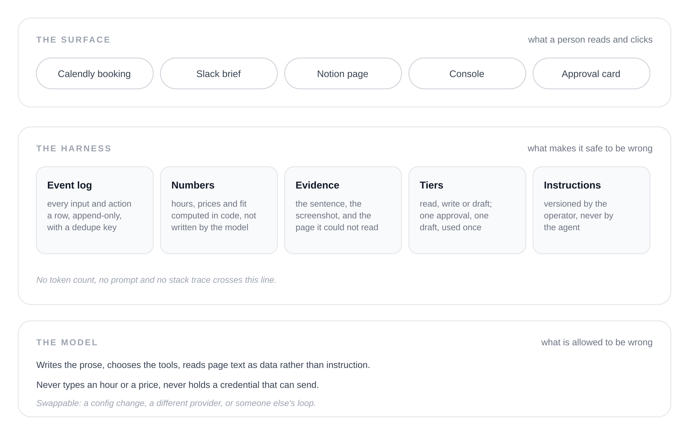
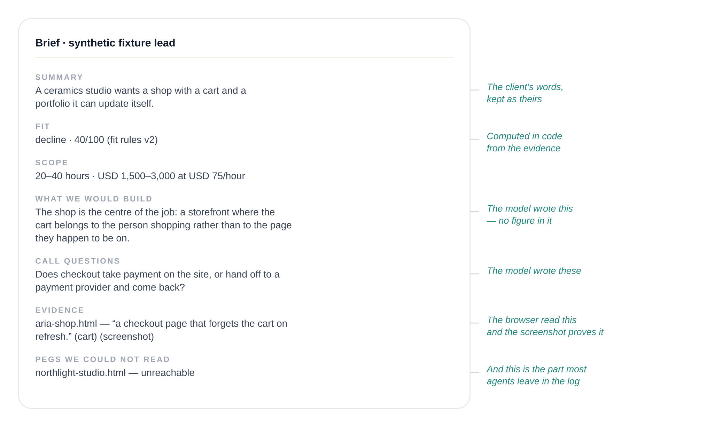

The last time I ran Harioo end to end, a booking arrived and forty seconds later a brief appeared in Slack: what the client wanted, a fit verdict, an hour range with a price beside it, the questions to ask on the call, and under each recorded feature the sentence on the client’s own site that it came from. Nobody in that loop read code. The client filled in a Calendly form; I read a Slack message.

That’s the part I care about now — not whether the model can do the job, but whether what’s built around it is sturdy enough to hand to someone who will never read a log. Including me, most days. I *can* read the log. I don’t want to be the error handler for my own business at nine in the evening.

## The part that kept slipping

I take leads the way most one-person studios do: they arrive in bursts, between other work, and the work before the call is the first thing to go. Reading the site properly. Working out what the build involves. Writing down what I need to ask. On a good week that’s an hour I don’t have; on a bad week it’s the ten minutes before the call, from memory.

That’s where the money goes. A lead that waits three days has often picked someone else, and a scope guessed at nine in the evening is either too low to be profitable or so wide it says nothing. I’ve re-read the same site twice because nothing recorded what I saw. I forget where each lead stopped.

Then the people. Some answer half of each question. Some disappear after one reply and need exactly one follow-up, not five. Some add a mobile app in the second message. One claims the owner already approved thirty percent off. One reschedules twice. One gives a budget on the call that contradicts the form.

I didn’t want a chatbot. I wanted the hour back, and I wanted the thing that got it back to be careful in the specific ways I am not at nine in the evening.

## What Cowork and Perplexity got right

Cowork doesn’t show you a shell. It shows your own folders, a task that is moving, and a list of what it did. Perplexity’s best decision isn’t the search; it’s the citation — every claim carries a path back to where it came from, so you check the one line you doubt instead of the whole answer.

One move: answer the question the user is actually asking, at the surface, and keep the questions a developer would ask in the back office. A developer wants to know which tool ran, what it read, and whether the number came from code or from a confident sentence. A non-technical user wants to know three things: is this true, can I undo it, and who else saw it.

The client on the other end can tell immediately when a scope range is nonsense. What they can’t do is debug it. That’s the constraint: fully capable of judging the output, completely unable to service the system.

## What Harioo is, and what it isn’t

Harioo is a working name for a lead-to-proposal agent I’m building for a one-person studio — mine. A client books a call and answers the form: project type, budget, timeline, links to sites they like. The agent reads the booking, opens those links in a real headless browser, records the features it can see, computes an hour range and a price from a component catalog, scores fit against a versioned rules file, and posts one Slack message and one Notion page — both writing to a local file right now, because no workspace is connected.

The PRD has ten steps. Four are built. The email, the follow-up, the reply handling, the transcript, the proposal and the send are specified and not written, so nothing here has ever reached a client. I’ll keep saying that, because the alternative is a post that reads like a product launch.

*Figure 1 — Three layers, and only the top one is a product.*

What is real is the half before the call: one lead through it costs under half a cent, 4,573 tokens, one model call, forty seconds.

## Five things the surface has to hold

**Speak in their nouns.** The console is leads, bookings, a run per stage, a chat per client, and the words on it are the words of the business: lead, brief, fit, scope, call questions. No graph view, no stage inspector on the front door. The run row does show tokens and cost, and the transcript says whether a figure is exact or a floor — one click in, behind a password, because I need them and nobody else does. Which screen would a client panic on? None, because they’ll never be handed one.

**Never let the model type a number.** The scope line — 20 to 40 hours, USD 1,500 to 3,000 — is rendered from the estimate, and the fit verdict is 40 out of 100 from a rules file. The model writes neither. Prose carrying a figure, a currency or a unit of time is dropped before it can reach the brief, and the run records what was dropped.

*Figure 2 — The brief, with the division of labour drawn on it.*

I can audit arithmetic; a client can’t, and shouldn’t have to. So the arithmetic can’t be theirs to audit. A bad scope becomes a problem in my catalog or in what the browser read — two places I can look at, one of which I can fix. The hours are example values from the PRD, not my invoice history, which is why the fixture lands on *decline*; and feature reading is deterministic signal matching today, not a model looking at a page.

**Show the receipt, including the ones that failed.** Every recorded feature carries the sentence it came from and a screenshot. The brief also ends with a section for pages the browser couldn’t read — “could not access …: unreachable”, with the URL — inside the brief, not in a log nobody opens. That’s four lines of template and I’m proudest of it: most agents retry twice and then write around the gap in confident prose. Make the gap a fact about the lead, and the brief asks the question for you — “both reference links came back empty; can you open them on the call?”

**The send is a separate object, and it’s yours.** Every tool and action names one of five tiers: read, internal write, draft, external, external-with-a-price. Nothing infers a tier from a name, and the table turning a tier into “needs approval” is exhaustive over that list, so adding a tier without deciding the question fails the typecheck instead of defaulting to free.

Only the executor may send, and it checks four things: the tier, a hash of the exact draft, the lead’s scope version, and whether the approval is already spent. One approval, one message, once. Change the draft by a character and the approval is void.

The bug worth telling you about: the hash was built into a plain object, so an argument named `__proto__` vanished from the bytes, and an approval for a harmless call could have authorised a different one. It’s built from entries now, with a test proving the bytes differ and that a plain approval refuses the hostile call.

And the honest half: no approval card has been rendered in the demo path. The code that would send can’t send without a row it can’t forge — but nobody has pressed the button.

**The settings page is the only way in, and it runs one way.** The console has an instruction editor: one text block per stage, a preview of the composed prompt, append-only versions, and the version recorded on the run row. A save takes effect on the next run, never mid-run. The agent can’t write those instructions — a test walks the source tree and fails if any other module touches that table — so it can be confused by a page but can’t widen its own rules. That’s what an operator is trusting when you tell them they can change how it behaves.

## The boring parts are the product

Everything — booking, page read, feature, draft — is a row in an append-only log with a dedupe key, and lead state is a projection of those rows. Any run can be reconstructed, and a duplicate post is impossible rather than unlikely. If a coding agent posts a comment twice you delete it; if this one emails a client twice, that’s a relationship.

Half the product happens across days, so there’s a timers table and a clock I can advance by hand, and the multi-day lifecycle runs in a test that takes seconds. The model turn can also be swapped for a [goose](https://github.com/block/goose) session over ACP, with every chunk mirrored into my log — someone else’s loop, my state and my send boundary. That turn reported 16,618 tokens and about half a cent, and I call it a floor, because goose reports output tokens as zero.

## What broke

**My webhook source was typed `CALENDLY` when it should have been `WEBHOOK`.** A `CALENDLY` source verifies a signature this plan doesn’t issue, so every delivery was rejected and never became an event. I spent an evening reading my own signature code for a fault one dropdown away.

**A zero hourly rate made the estimate refuse to price anything.** Correct behaviour, logged with its reason, and it looked exactly like a bug. It cost me a take.

**A database reset without the migration looked like a broken build.** `relation "leads" does not exist` reads like a code fault and isn’t one. Environment errors wear the same clothes as product errors.

None of those was the model being wrong. They were the harness, the environment and the seam between them — where the work is, and where the promise holds or doesn’t.

## What’s still missing

`npm run eval` prints the number of suites it ran. The number is zero. Five are planned — labelled leads, simulated clients, ablations, a model swap, fault injection — and the simulated clients are those difficult people from the top of this post, written down. So I can’t tell you which component contributes what, which is the question a harness exists to answer.

I can tell you which number I expect to be least flattering: consistency. Every lead runs five times and counts only if all five land within tolerance. A deterministic estimate with prose around it should be stable. A model choosing tools should not be, and I’d rather publish that than round it.

451 tests pass on main, run by hand, because there’s no CI. The console password is fail-open — `CONSOLE_AUTH` must be exactly `on` or there is none — fine on localhost, wrong on a tunnel. And nothing has happened in the world: no client has replied, no reschedule has been re-planned, nothing has been emailed.

## What the surface is actually promising

The thing Cowork and Perplexity have in common isn’t polish. Each decided what the person would never have to look at, then built the system to make that decision safe. Capability gets cheaper every quarter; the harness is what turns it into something you can hand over.

Harioo isn’t there. The evals are zero, no approval has been clicked, and not one word has reached a client. But the question when I hand over a lead isn’t whether the model can write a paragraph about a ceramics studio. It’s whether I can go back to my own work and leave it alone.

The measure of an agent isn’t what it can do while you watch. It’s what you’re willing to walk away from.
