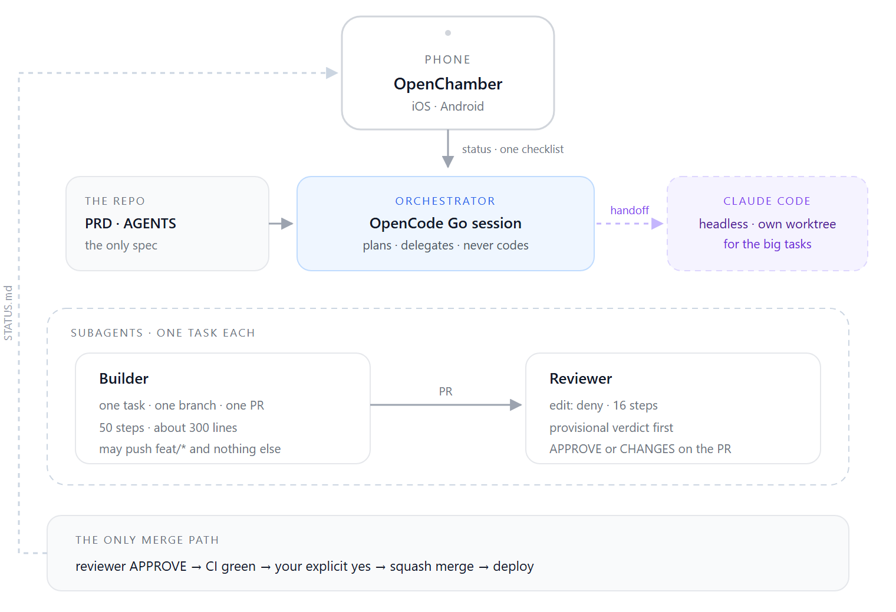
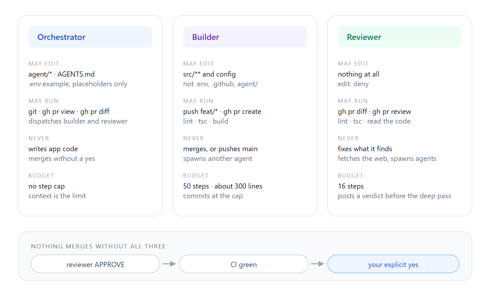
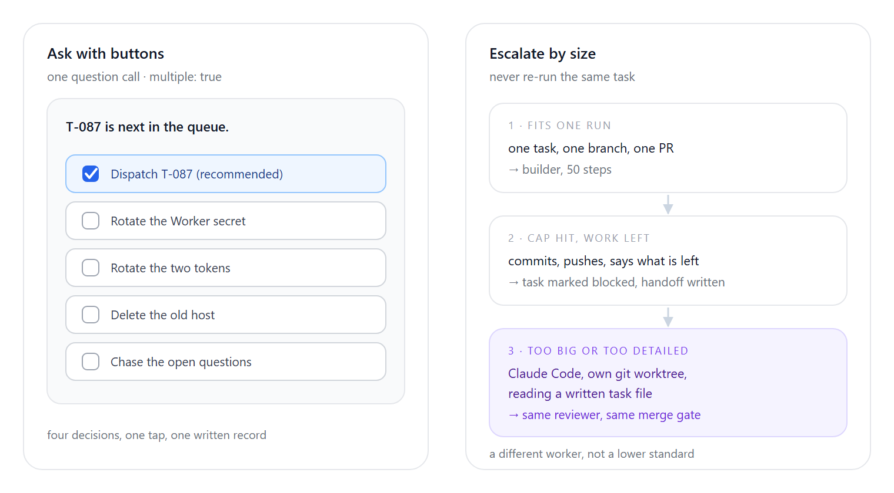

I freelance, and my calendar is packed with client calls. The hours I have for my own product are the seams between them: twenty minutes before a standup, the queue at the bank, the last hour before I fall asleep with my phone still in my hand.

*Findly*, a social app for interior designers, has been built almost entirely in those seams. What made that possible is a custom agent harness built around my schedule.

*Figure 1 — The loop. A phone session reads a five-line status, answers one checklist, and a PR comes back through a gate I control.*

## The pieces, and the contract between them

I needed a setup that was both efficient and flexible. OpenCode Go fit: its monthly plan gives generous access to lower-cost models such as **DeepSeek V4.1 Flash**. OpenCode is the agent runtime, a coding session on my machine with shell, edit, git, and `gh`. OpenChamber is the client: desktop for the long passes, Android and iOS for everything else, which is most of it. Claude Code is the escape hatch, running headless in its own git worktree when a task is bigger than one agent run.

The contract is two files. `agent/PRD.md` is product scope: numbered features, each with the behaviour it must have. `AGENTS.md` is the constitution: stack, commands, conventions, and what nobody may touch. Every queued task cites a PRD section, so "build me a thing" becomes a specific piece of the product.

If I ask for something the PRD doesn't cover, the orchestrator says so and marks the task blocked instead of inventing scope. That one rule is worth more than any prompt I've written. It stops an agent from confidently building the wrong app.

## The org chart

All three agents run the same model. What separates them is permission.

*Figure 2 — Three roles, three permission sets, one gate. The reviewer's power is that it cannot fix anything.*

**The orchestrator** is the only agent I talk to, and it never writes app code. Its edit permission is deny-all with three exceptions: `agent/`, `AGENTS.md`, and `.env.example`. It turns a paragraph into queued tasks with acceptance criteria, dispatches them, reads CI, and asks before merging. If it catches itself reaching for a source file, its instructions tell it to delegate.

**The builder** gets one task, one branch, one pull request, fifty steps, and a soft ceiling of about three hundred changed lines. It may push `feat/*` and nothing else: no `main`, no `.env`, no migration without an explicit ask. Every run ends with a `Needs handoff:` line, even if it says "none", because the real failure is a terse run that omits the field and lets unfinished work pass as done.

**The reviewer** has `edit: deny`, sixteen steps, no web access, and no ability to spawn agents. It posts a provisional verdict on the PR before reading deeply, then amends it if the deep read changes its mind. The order is deliberate: runs get cut off, and a verdict that lives only in a chat message that never came back is worth nothing. Its job is literal: each acceptance criterion against the diff, pass or fail.

The split isn't about intelligence. A review only means something if the reviewer can't quietly fix what it found. One agent guards the queue, one can write but has no say over scope, and one can judge but can't write.

And nothing merges alone. `gh pr merge` is an ask, granted to exactly one agent and honoured only after I say yes in that session. The reviewer approves, CI goes green, and a checklist line arrives: "Merge #154."

## Ask me with buttons

I read on a phone, so every check-in has a fixed shape: a status in five lines or fewer, then exactly one multiple-choice question with two to five options, multiple answers allowed, the recommended one first and marked. I tick "Merge #153" and "Rotate the token" and submit in one tap.

Prose questions are effectively banned, because a paragraph on a phone becomes homework. The side effect is a decision log. Last week's status entry reads: "he ticked *Dispatch T-087*; his other four options went unticked." That is the entire record of a session, and it's more honest than any summary written afterwards.

*Figure 3 — Left: the only shape a check-in takes. Right: what happens when a task does not fit one run.*

## Escalate by size, do not retry

Small agent runs fail predictably: they exhaust their steps mid-feature with the work uncommitted. The obvious fix, more steps, was wrong, and the usage data said so. Nine of fifty-eight builder runs stopped at exactly the old ceiling of sixty, and nineteen of forty-nine reviews at exactly twenty. The cap had become the budget.

So I stopped treating the cap as a wall and changed what happens when an agent hits it. It commits, pushes, opens a draft PR if there isn't one, and reports. If real work remains, the task isn't re-dispatched. It's marked blocked with a written handoff: the branch, what's done, what's left, and the next command to run. Claude Code then picks it up headless in a fresh worktree, reading that file, and inherits the same reviewer and the same no-merge rule.

That last part matters more than it sounds. The lazy version of this workflow is "ask the strong model when the weak one struggles", which turns every hard task into an unbounded session with no verdict.

## What the phone experiment actually changed

I still don't prefer working from a phone. I'm too fond of my multi-screen setup. But the harness taught me something: work flows more smoothly once the unit of my attention is a **decision** instead of a task.

What I want is the arrangement a real organization already has with a junior developer. I spend less time guiding an agent through back and forth, and I trust them to communicate clearly and briefly, so the only thing left for me is the decision. They do the hard work: summarizing the paths that could succeed, naming the tradeoffs, and surfacing a few options, as infrequently as possible. That leaves me free for the dozens of other things going on in my life.
