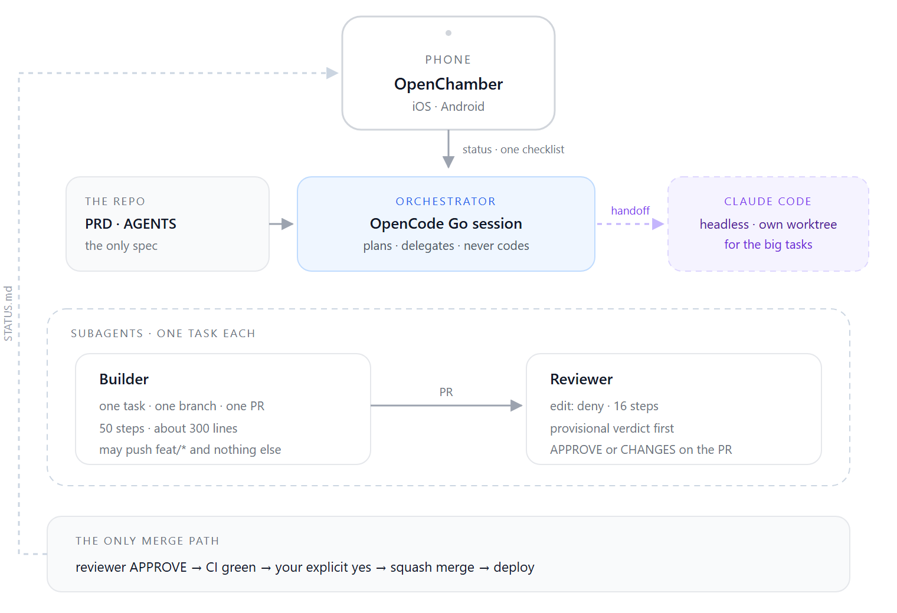
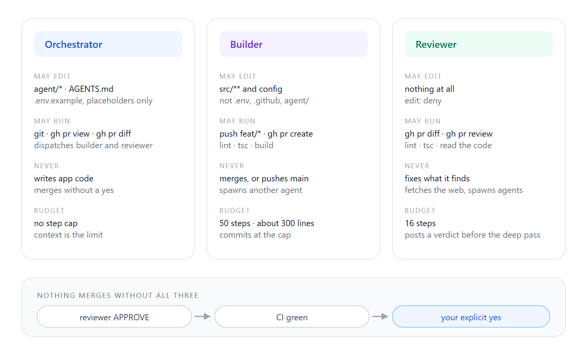
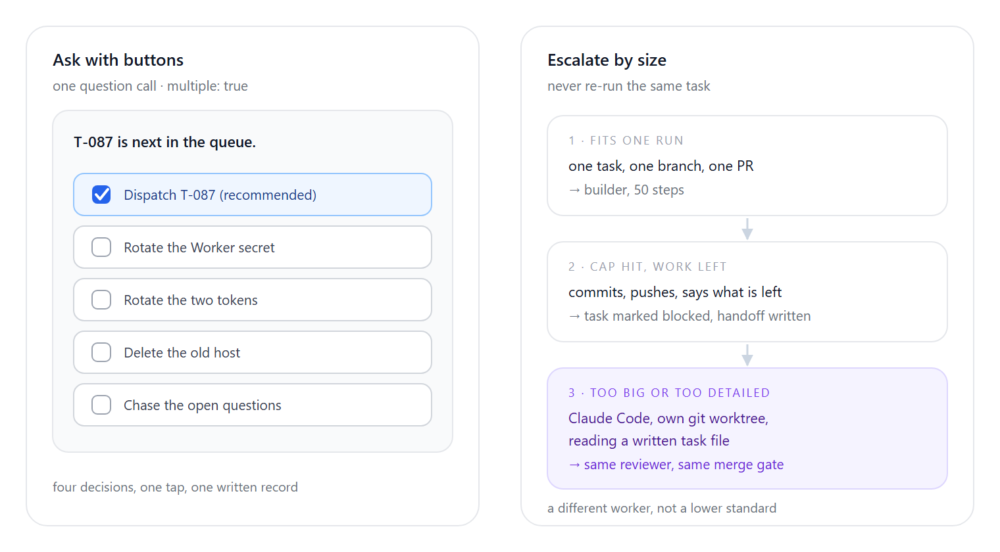

I freelance. My calendar is filled to the brim with client calls, and the hours I have for my own product are the seams between them: twenty minutes before a standup, the queue at the bank, the last hour before I inevitably sleep with my hands still clutched to my mobile device.

*Findly*, a social app for interior designers, has been built almost entirely in those seams.

What made that possible was a custom-built agent harness and workflow built specifically for my hectic schedule.

*Figure 1 — The loop. A phone session reads a five-line status, answers one checklist, and a PR comes back through a gate I control.*

## The pieces, and the contract between them

Out of all the plans available out there, I needed to find one that was both efficient and flexible. 

OpenCode Go ticked all the boxes for me. Not only does the monthly Go plan give you a generous amount of access to lower-cost models such as **DeepSeek V4.1 Flash**

is the agent runtime: a coding session on my machine with tools — shell, edit, git, `gh`. OpenChamber is the client. Desktop for the long passes; the Android and iOS apps for everything else, which is most of it. Claude Code is the escape hatch, running headless in its own git worktree when a task is bigger than one agent run.

The contract is two files. `agent/PRD.md` is product scope: numbered features, each with the behaviour it must have. `AGENTS.md` is the constitution — stack, commands, conventions, and the list of things nobody may touch. Every queued task cites a PRD section, so "build me a thing" becomes a specific piece of the product. If I ask for something the PRD does not cover, the orchestrator says so and marks the task blocked rather than inventing scope. That one rule is worth more than any prompt I have written: it is what stops an agent from confidently building the wrong app.

## The org chart

All three agents run the same model. What separates them is permission.

*Figure 2 — Three roles, three permission sets, one gate. The reviewer's power is that it cannot fix anything.*

**The orchestrator** is the only agent I talk to, and it never writes app code. Its edit permission is a deny-all with three exceptions: `agent/`, `AGENTS.md`, and `.env.example` for placeholders. It turns a paragraph into queued tasks with acceptance criteria, dispatches them, reads CI, and asks before merging. Its instructions tell it to delegate if it catches itself reaching for a source file.

**The builder** gets one task, one branch, one pull request, fifty steps and a soft ceiling of about three hundred changed lines. It may push `feat/*` and nothing else. No `main`, no `.env`, no migration without an explicit ask. Every run ends with a `Needs handoff:` line, even "none", because the real failure is a terse run that omits the field and lets unfinished work pass as done.

**The reviewer** has `edit: deny`. Sixteen steps, no web access, no ability to spawn agents. It posts a provisional verdict on the PR before it reads deeply, then an amendment if the deep read changes its mind. That ordering is deliberate: runs do get cut off, and a verdict that exists only in a chat message that never came back is worth nothing. Its whole job is literal — each acceptance criterion against the diff, pass or fail.

The split is not about intelligence. Reviewing only means something if the reviewer cannot quietly fix what it found. One agent guards the queue, one has write access without judgement over scope, one has judgement without write access.

And nothing merges alone. `gh pr merge` is an ask, granted to exactly one agent, and honoured only after I say yes in that session. Reviewer approves, CI is green, then a checklist line arrives: "Merge #154."

## Ask me with buttons

I read on a phone. So every check-in has a fixed shape: status in five lines or fewer, then exactly one multiple-choice question with two to five options, multiple answers allowed, the recommended one first and marked. I tick "Merge #153" and "Rotate the token" and submit in one tap.

Prose questions are effectively banned, because a paragraph on a phone becomes homework. The side effect is a decision log. Last week's status entry reads: "he ticked *Dispatch T-087*; his other four options went unticked." That is the entire record of a session, and it is more honest than a summary anyone would have written afterwards.

*Figure 3 — Left: the only shape a check-in takes. Right: what happens when a task does not fit one run.*

## Escalate by size, do not retry

Smaller agent runs fail predictably: they exhaust their steps mid-feature with the work uncommitted. The obvious fix — more steps — was wrong, and the usage data said so. Nine of fifty-eight builder runs had stopped at exactly the old ceiling of sixty; nineteen of forty-nine reviews at exactly twenty. The cap ended up becoming the budget.

So I scrapped the hard limit for steps and tried something else. At the cap, an agent commits, pushes, opens a draft PR if there is not one already, and reports. If real work remains, the task is not re-dispatched. It is marked blocked with a written handoff: branch, what is done, what is left, the next command to run. Then Claude Code picks it up headless in a fresh worktree, reading that file. It inherits the same reviewer and the same no-merge rule.

That last part matters more than it sounds. The lazy version of this workflow is "ask the strong model when the weak one struggles", which turns every hard task into an unbounded session with no verdict.

## What the phone experiment actually changed

I still don't prefer working from a phone. I adore my multi-screen set up too much. But what this custom harness shows, is that things flow more smoothly once I decide that the units of my attention are **decisions** instead of task.

I prefer the arrangement a real organization already has with a junior developer. I spend less time guiding an agent through the back and forth, and I trust them to communicate clearly and briefly, so the only thing left for me is the decision. They do the hard work. They summarize the paths that could succeed, name the tradeoffs, and surface a few options. They ask as infrequently as possible.

